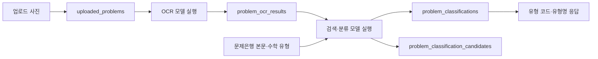

# 사진 문제의 수학 유형 분류를 위한 DB

## 일단 pull 받고 밑의 명령어를 최상위 폴더에서 실행.
```powershell
python -B backend/scripts/setup_problem_classification.py
```

문제은행과 분류 DB 테스트를 함께 실행하려면:

```powershell
python -B -m unittest discover -s backend/tests -p 'test_problem*_db.py' -v
```

회원관리 없이 **문제은행 → 업로드 사진 → OCR 결과 → 수학 유형 분류 결과**에 필요한 저장 구조를 구성했습니다.

## 1. 분류 기준

기존 `topics` 테이블에 **수학 세부 유형 1,165개**의 코드와 이름이 있고,
`questions`의 **전체 30,339문항**은 각각 해당 유형에 연결되어 있습니다.
학년·학기·단원·대표 개념·태그도 문항에 저장되어 있습니다.

유형의 학년·학기·단원별 문항 수는 새 `problem_topic_catalog` 뷰로 조회할 수 있습니다.
하나의 유형 코드가 여러 단원에 나타나는 경우가 있어, 유형 코드를 단원 하나에 강제로 고정하지 않았습니다.

비교용 50문항의 `recognition_type`(한글 문장 중심, 부호·괄호·분수 등)은 OCR 평가용 묶음입니다.
사진 문제에 반환할 **수학 유형은 `source_topic_code`, `source_topic_name`**입니다.

## 2. 추가한 저장 구조

| 테이블 / 뷰 | 저장하거나 조회하는 내용 |
| --- | --- |
| `uploaded_problems` | 업로드 사진 원본 바이트, 파일명, MIME 형식, SHA-256, 업로드 시각 |
| `problem_ocr_results` | 어느 사진을 어떤 OCR 모델·버전·파이프라인으로 읽었는지, 인식 텍스트·수식·도형 설명, 성공/실패 |
| `problem_classifications` | 어느 OCR 결과를 분류했는지, 분류 방법·모델·버전, 최종 유형, 선택적 매칭 문항, 신뢰도, 근거, 실패 사유 |
| `problem_classification_candidates` | 분류 시 고려한 후보 유형의 순위, 대표 매칭 문항, 점수 종류·값, 근거 |
| `problem_topic_catalog` (뷰) | 학년·학기·단원별 수학 유형과 문제은행 문항 수 |
| `question_classification_corpus` (뷰) | 분류/검색에 쓸 전체 문항 본문·유형 정보. 정답과 해설은 제외 |
| `classified_problems` (뷰) | 업로드 사진 → OCR → 분류 결과 → 유형명을 연결한 조회 결과 |
| `problem_schema_migrations` | 이번 분류 저장 구조의 적용 이력과 SQL 해시 |

기존 유형에 없는 코드는 외래키로 거부합니다.
매칭한 문항과 분류 유형이 서로 다르면 트리거로 거부합니다.
OCR 실패 결과에는 분류를 연결할 수 없습니다.
같은 사진에 여러 모델의 OCR 결과, 같은 OCR에 여러 분류 결과를 저장할 수 있습니다.
시각은 UTC 문자열로 저장하며 화면에서 필요할 때 한국 시간으로 변환합니다.

**문제은행에 없는 새 문제**도 `matched_question_id = NULL`로 두고 유형만 저장할 수 있습니다.
분류하지 못한 문제는 `status = 'unclassified'`, 유형은 `NULL`로 저장합니다.
실패한 분류는 `status = 'failed'`로 두고 `error_message`에 원인을 기록합니다.
`confidence`는 제공되는 경우에만 0~1로 저장합니다. 없는 값을 임의로 채우지 않습니다.
후보 점수는 모델에 따라 의미가 다르므로 `score_name`과 `score`를 함께 저장합니다.


DB 위치는 `data/problem_bank/didgo.sqlite3`이며 `--database`로 바꿀 수 있습니다.
이전 `build_problem_bank.py`는 기본 DB만 만듭니다. 분류 저장 구조까지 만들 때는 위 새 스크립트를 사용합니다.


## 4. 이후 서비스가 저장할 흐름



모델 실행 후 서비스 코드에서 사진, OCR 결과, 분류 결과를 순서대로 INSERT하면 됩니다.
SQLite는 쓰기 연결마다 `PRAGMA foreign_keys = ON`을 실행해야 합니다.
사진 SHA-256은 실제 이미지 바이트에서 계산하고, OCR/분류 모델·버전 정보를 함께 기록합니다.
DB는 저장과 연결을 담당합니다. 사진의 실제 OCR, 유사도 검색, 임베딩 생성, 모델의 유형 판단,
업로드 API와 화면은 이번 작업에 포함하지 않았으며 이후 구현이 필요합니다.
현재 실제 업로드 데이터는 없으므로 새 운영 테이블은 비어 있습니다. 테스트 데이터는 임시 DB에서만 사용합니다.

## 5. 조회 예시

```sql
-- 중1 1학기 문자와 식 유형 목록
SELECT source_topic_code, source_topic_name, question_count
FROM problem_topic_catalog
WHERE grade = 1 AND semester = 1 AND unit_code = '03'
ORDER BY source_topic_code;

-- 분류/검색 모델이 참조할 본문과 유형
SELECT id, question_text, source_topic_code, source_topic_name
FROM question_classification_corpus
ORDER BY id;

-- 모델 성능 평가 시 비교용 문항을 참조 데이터에서 제외하는 예시
SELECT c.* FROM question_classification_corpus c
WHERE NOT EXISTS (SELECT 1 FROM benchmark_items b WHERE b.question_id = c.id)
ORDER BY c.id;

-- 특정 사진의 모든 분류 결과 (물음표에는 업로드 ID를 바인딩)
SELECT classification_id, ocr_text, status, source_topic_code,
       source_topic_name, matched_question_id, confidence, model_name, pipeline_version
FROM classified_problems
WHERE uploaded_problem_id = ?
ORDER BY classification_id;

-- 특정 분류 결과의 후보 유형
SELECT c.rank, c.source_topic_code, t.source_topic_name,
       c.matched_question_id, c.score_name, c.score
FROM problem_classification_candidates c
JOIN topics t ON t.source_topic_code = c.source_topic_code
WHERE c.classification_id = ?
ORDER BY c.rank;
```
전체 문제은행을 검색에 사용하는 서비스 동작과,
공통 평가 문제를 참조 데이터에서 제외하는 모델 비교 실험은 목적에 맞게 조회를 선택합니다.

**회원·로그인·결제·학습 이력 테이블은 추후에,, 추가 해볼게요?**
